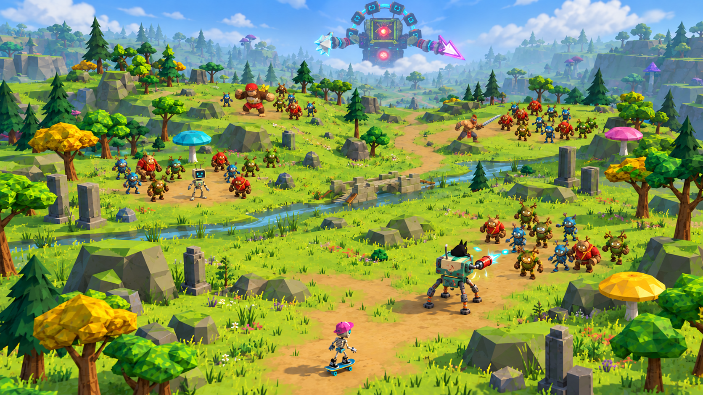

# NDJ — игровой синематик и Blender-превиз

Мы создаём **18-секундный фрагмент игрового синематика**: камера отлетает от огромного Майнфрейма в небе, проходит спиной вперёд через несколько боёв, а в финале скелет на скейте ловит её рукой и бьёт лбом в объектив.

Репозиторий хранит упрощённую сцену Blender, рендер движения камеры, расстановку героев и мобов, оригинальные референсы и отдельные визуальные кадры для последующей работы с **Seedance**. Цель текущего этапа — согласовать пространство, масштаб, движение камеры и читаемость действия перед финальной генерацией видео.



## Актуальная версия — revision-04

- [Видео-превиз — 18 секунд, 24 кадра/с, 960 × 540](assets/teaser/blender-blockout/revision-04/camera_blockout_18s_v4.mp4)
- [Скачать сцену Blender](assets/teaser/blender-blockout/revision-04/camera_blockout_18s_v4.blend)
- [HTML-галерея для локального просмотра](assets/teaser/blender-blockout/revision-04/index.html)
- [Фактическая расстановка в Blender](assets/teaser/blender-blockout/revision-04/layout-overview.png)
- [Вид сверху и траектория камеры](assets/teaser/blender-blockout/revision-04/layout-top.png)
- [Скрипт построения сцены](assets/teaser/blender-blockout/build_scene.py)

После скачивания репозитория откройте HTML-галерею в браузере. GitHub показывает её исходный код; встроенные изображения в этом README можно смотреть прямо здесь.

## Сценарий и камера

Майнфрейм появляется в разрыве простого игрового неба и остаётся неподвижным. Он не преследует камеру и не атакует землю.

Камера сначала медленно отдаляется, затем ускоряется назад по плавной извилистой траектории. Объектив смотрит в сторону босса и уже пройденной части поля. Во время пролёта взгляд меняется плавно, без последовательного наведения на каждого героя.

Основная часть пролёта проходит примерно на высоте пояса — около 1,2 м, с небольшими перепадами. Перед скелетом предусмотрен один подъём. Скелет замечает камеру, обхватывает её пальцами, после чего движение становится ведомым кистью. В финале — удар лбом и трещины на объективе.

Ориентировочный ритм: 0–5 с — босс; 5–7 с — разгон и спуск; 7–14 с — поле боя; 14–18 с — скелет, захват и удар.

## Герои и бои

| Герой | Текущая постановка |
| --- | --- |
| Воин | Рыжий ирокез и борода, синяя краска на лице, один серебряный наплечник; бой с длинным серебряным мечом. |
| Обезьяна | Коричневая горилла в красной кепке и шортах, белая майка с бананом, корзина бананов за спиной; ближний бой. |
| Глитч | Стройный кремовый гуманоидный CRT-робот с голубой мордой и двумя антеннами. Механика боя пока не определена; нейтральный placeholder. |
| Робот с кошкой | Отдельный широкий кремово-бирюзовый CRT-робот с чёрной кошкой сверху. Четыре ноги: две широкие передние с пальцами и две тонкие задние с круглыми опорами. Развёрнут спиной к камере и стреляет ручным бластером по мобам впереди. |
| Скелет | Голубые глаза, розовая кепка, чёрные кеды и скейт с бирюзовыми колёсами; ловит камеру рукой. |

Глитч и робот с кошкой — **два разных персонажа**.

На поле 40 мобов, по 10 у каждой зоны. Все группы размещены на земле и постоянно существуют в сцене. Враги — деревянные существа с рогами-ветками и глазами-крестами: синие стройные, красные массивные с рюкзаком и зелёные приземистые. У каждого две руки, две ноги и два глаза. В блокинге используются простые смещения целого тела.

## Пространство и стиль

Основание сцены — 52 × 104 м. Между зонами боёв предусмотрены расстояния, изгибы маршрута и естественные заслоны: невысокие холмы, камни и редкие угловатые деревья. Мир остаётся открытым зелёным полем с руинами и крупными цветными грибами.

Целевой стиль — low-poly с пиксельными текстурами, простое голубое небо и мягкая дальняя дымка. Оригинальные формы персонажей сохраняются.

Общий сгенерированный кадр — визуальная интерпретация постановки. Точное размещение объектов и размеры следует смотреть в `.blend`, рендерах расстановки и [scene-metrics.json](assets/teaser/blender-blockout/revision-04/scene-metrics.json).

## Кадры персонажей

- [Воин с мечом и группой мобов](assets/teaser/blender-blockout/revision-04/character-frames/01-warrior-sword.png)
- [Обезьяна и группа мобов](assets/teaser/blender-blockout/revision-04/character-frames/02-monkey-crowd.png)
- [Робот со спины, бластер и мобы впереди](assets/teaser/blender-blockout/revision-04/character-frames/03-robot-back-blaster.png)
- [Скелет держит камеру: пальцы по краям объектива](assets/teaser/blender-blockout/revision-04/character-frames/04-skeleton-camera-grab.png)
- [Глитч: нейтральный кадр](assets/teaser/blender-blockout/revision-04/character-frames/05-glitch-neutral.png)

Изображения созданы встроенным `image_gen` на основе оригинальных референсов. [Промпты текущей итерации](assets/teaser/blender-blockout/revision-04/generation-prompts.json) сохранены для продолжения работы. Это рабочие референсы, а не финально утверждённые кадры.

## Воспроизведение

Проверено в Blender 5.2.2. Визуализация использует Workbench; для сборки MP4 нужен FFmpeg.

Из корня репозитория:

```sh
blender -b -t 4 --python assets/teaser/blender-blockout/build_scene.py
ffmpeg -y -framerate 24 -i assets/teaser/blender-blockout/revision-04/preview/frame_%04d.png -c:v libx264 -crf 19 -pix_fmt yuv420p -movflags +faststart assets/teaser/blender-blockout/revision-04/camera_blockout_18s_v4.mp4
```

Для проверки анатомии мобов и пересечения камеры с холмами:

```sh
blender -b assets/teaser/blender-blockout/revision-04/camera_blockout_18s_v4.blend --python assets/teaser/blender-blockout/revision-04/audit_scene.py
```

Текущая проверка: 40 мобов, по две руки, две ноги и два глаза у каждого; пересечений камеры с проверяемыми холмами на основном низком пролёте не найдено. Это ограниченная техническая проверка, художественная постановка оценивается по видео.

## Текущий этап

Сцена Blender намеренно упрощена до читаемых примитивов. Она служит планом пространства и движения. Детальная анимация боёв, финальный вид Майнфрейма, разрыв неба и итоговое видео Seedance остаются следующим этапом работы.
