<div align="center">

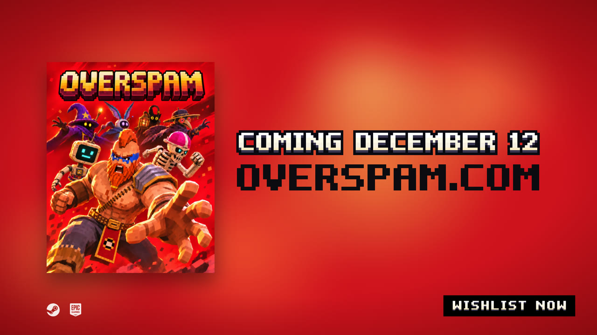

# OVERSPAM — вставки для трейлеров

**Remotion-вставки, оверлеи и концовки для Steam-тизера и геймплейного трейлера игры [OVERSPAM](https://overspam.com)**<br>
3D survivor roguelite · 1920×1080 · 60 fps · всё рендерится кодом

[Галерея](#-галерея) · [Быстрый старт](#-быстрый-старт) · [Как устроено](#-как-устроено) · [Документы](#-документы)

</div>

---

## 🎬 Галерея

Монтаж в CapCut, отсюда — готовые вставки. Секунда в таблицах — с какого момента трека ставить клип.

### Тизер · трек `teaser60c_v2`

<table>
<tr>
<td width="50%" valign="top">
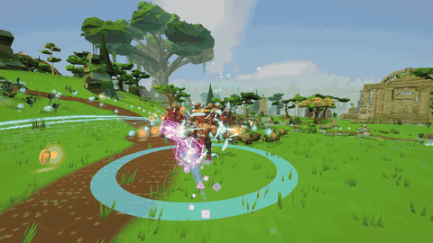<br>
<b>Объёмная надпись</b> · <code>title-overlay-3d.mov</code><br>
Прозрачный MOV. Надпись прилетает, на <b>0,5 с</b> встаёт в объём, камера пролетает сквозь неё в геймплей.<br>
<sub>▶ 20,19 с — удар на дроп 20,69</sub>
</td>
<td width="50%" valign="top">
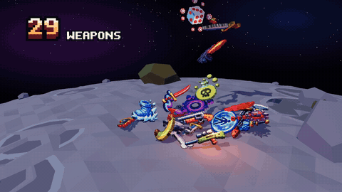<br>
<b>Куча лута</b> · <code>OS-BuildPile</code><br>
141 воксельный предмет падает на луну с настоящей физикой, счётчики 33 / 23 / 85, на дропе — <b>1 BUILD / NOBODY PLANNED</b>.<br>
<sub>▶ 16,80 с · 6 с</sub>
</td>
</tr>
<tr>
<td valign="top">
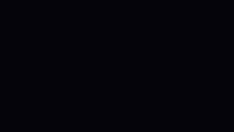<br>
<b>5 боссов залпом</b> · <code>OS-BossSalvo</code><br>
Боссы падают на пять затухающих ударов трека, потом «5 BOSSES» и наезд до возврата бочки.<br>
<sub>▶ 35,60 с · 2 с</sub>
</td>
<td valign="top">
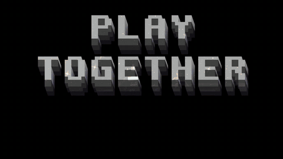<br>
<b>PLAY TOGETHER</b> · <code>OS-PlayTogether</code><br>
Приём Borderlands: белые буквы на чёрном, в них проступает кадр; щелчок — и персонажи стоят <i>перед</i> жёлтым словом (вырезка SAM 2).<br>
<sub>1,6 с · щелчок внутри</sub>
</td>
</tr>
<tr>
<td valign="top">
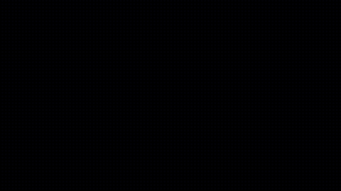<br>
<b>Концовка тизера</b> · <code>OS-BLEnd</code><br>
Удар на арт, отъезд в квадрат, красный фон с дымом, рваная сборка COMING DECEMBER 12 и WISHLIST NOW.<br>
<sub>▶ 55,98 с — склейка на финальный удар 56,08</sub>
</td>
<td valign="top">
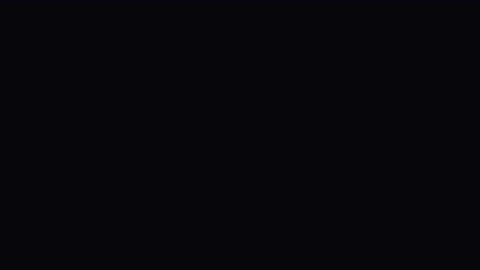<br>
<b>5 WORLDS</b> · <code>OS-WorldsSplit</code><br>
Пять косых карт миров влетают по полудолям с параллаксом, на сильную долю — надпись.<br>
<sub>1,8 с · 110 BPM</sub>
</td>
</tr>
</table>

### Геймплейный трейлер · трек `combat_surge_68s_cut`

<table>
<tr>
<td width="50%" valign="top">
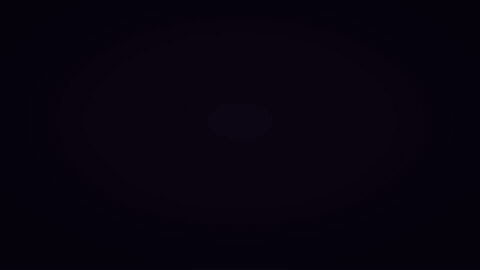<br>
<b>AVAILABLE NOW</b> · <code>OS-EndPlay</code><br>
Логотип падает, курсор подъезжает и жмёт <b>PLAY</b> — щелчок, вспышка, пиксели разлетаются.<br>
<sub>▶ 57,82 с — клик на финальный удар 59,72 · до конца трека</sub>
</td>
<td width="50%" valign="top">
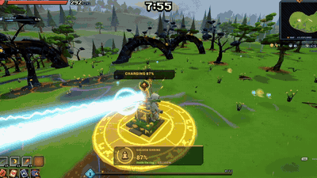<br>
<b>Шрайны</b> · <code>OS-Shrines</code><br>
Золотой → обычный → золотой: захват, карты, выбор, удар в землю со свечением цвета шрайна.<br>
<sub>7,97 с</sub>
</td>
</tr>
<tr>
<td valign="top">
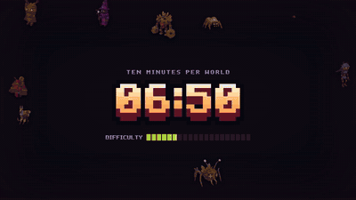<br>
<b>OVERTIME</b> · <code>OS-Overtime</code><br>
10:00 сбегает к нулю, уровни DEADLY → OVERSPAM, мобы превращаются в призраков и заливают экран.<br>
<sub>10,3 с</sub>
</td>
<td valign="top">
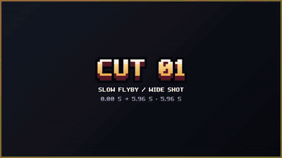<br>
<b>Опенер</b> · <code>OS-OpenerCuts</code><br>
Пролёт, 12 быстрых склеек на щелчки, COMING SOON / OVERSPAM, дата.<br>
<sub>13,3 с · своя звуковая дорожка</sub>
</td>
</tr>
</table>

<details>
<summary><b>Ещё вставки и прозрачные плашки</b></summary>

| Композиция | Что внутри |
|---|---|
| `chests.mp4`, `OS-ChestsOpen` | открытия сундуков в долю, карточки наград, счётчик CHESTS |
| `cards.mp4`, `cardsfan.mp4`, `OS-CardsPick` | LEVEL UP: рероллы карт, веер из 23 карт, выбор с золотым свечением |
| `herotag-*.mov` | прозрачная плашка героя: имя, роль, пассивка |
| `maptag-*.mov` | прозрачные метки: SHRINES, GOLDEN SHRINES, CHESTS, GOLD POTS, PORTALS, BOSS ALTARS |
| `boss-1..5.mov` | плашки боссов с полосой HP поверх стоп-кадра |
| `worlds`, `heroes`, `weapons`, `items`, `build`, `end` | первая серия счётчиков в стиле DRG: Survivor |

Полный список с таймкодами — [overspam/INSERTS.md](overspam/INSERTS.md), подробности по каждой — [overspam/README.md](overspam/README.md).
</details>

---

## 🚀 Быстрый старт

Нужны Node 20+ и ffmpeg.

```bash
cd overspam
npm install
npm run studio                                   # Remotion Studio: смотреть и крутить композиции
npx remotion render src/index.ts OS-EndPlay out/end-play.mp4
npx remotion still  src/index.ts OS-BuildPile out/pile.png --frame=224
npm run overspam                                 # пакетный рендер вставок из content/overspam/teaser.json
```

Пересчитать физику кучи после правок: `npx tsx scripts/build-pile-sim.ts` → `public/overspam/pile_sim.json`.

> Тяжёлые исходники не лежат в репо: кадры и вырезки для PLAY TOGETHER (`public/overspam/pt_src`, `pt_fg`), клипы шрайнов (`public/footage/shr`) и звуки из сторонних паков (`public/sfx/lib`). Без них эти композиции отрендерятся без видео или звука.

---

## 🧩 Как устроено

```
overspam/
├─ src/overspam/        композиции Remotion (Compositions.tsx — список всех)
│  ├─ BuildPile.tsx     куча лута: three.js + предрасчитанная физика
│  ├─ voxel.tsx         пиксель-арт PNG → воксельная 3D-модель, рубашки и подписи карт
│  ├─ BossSalvo.tsx · PlayTogether.tsx · BLEnd.tsx · EndPlay.tsx · Shrines.tsx …
│  └─ PixelText.tsx     игровой пиксельный шрифт из билда
├─ scripts/
│  ├─ build-pile-sim.ts физика кучи на cannon-es, один раз → JSON
│  ├─ sam2_mask.py      вырезка персонажей из клипа (SAM 2.1)
│  └─ overspam_extract.py  ассеты из Unity-билда игры
├─ public/overspam/     логотип, шрифт, иконки, карты, боссы, герои
└─ content/overspam/    teaser.json — тексты, BPM, тайминги вставок
```

| Приём | Как сделано |
|---|---|
| **Воксели из пиксель-арта** | каждый непрозрачный пиксель иконки становится кубиком, толщина по типу (оружие 12, предмет 3, карта 12); у карт сгенерирована рубашка и подпись игровым шрифтом |
| **Физика без «дрожи»** | Remotion рендерит кадры не по порядку, поэтому физика считается заранее: 141 объект × 300 кадров, пол — сфера луны радиусом 110 |
| **Персонаж перед текстом** | SAM 2.1 ведёт маску робота и скелета по всем 149 кадрам клипа, текст рисуется между фоном и вырезкой |
| **Синхрон с музыкой** | доли и удары найдены по огибающей трека; каждая вставка проверяется версией «с треком» |
| **Звук** | щелчки и удары — ElevenLabs и библиотека паков; ключ API хранится вне репо |
| **Ассеты из игры** | логотип 60×14, шрифт, иконки 30 оружий, 85 предметов и 23 карт вытащены из билда через UnityPy |

---

## 📚 Документы

| Файл | О чём |
|---|---|
| [overspam/INSERTS.md](overspam/INSERTS.md) | все вставки и где они стоят в треках |
| [overspam/README.md](overspam/README.md) | пайплайн тизера, параметры, извлечение ассетов |
| [overspam/PLAN.md](overspam/PLAN.md) | план трейлера и решения владельца |
| [overspam/BUILD_PILE.md](overspam/BUILD_PILE.md) | задумка кучи лута, задания Codex: `CODEX_VOXEL_TASK*.md` |
| [overspam/MOTION_GUIDE.md](overspam/MOTION_GUIDE.md) | правила движения и монтажа |
| [overspam/SOUND.md](overspam/SOUND.md) · [SOUND_MAP.md](overspam/SOUND_MAP.md) | звук и где он стоит |
| [NDJ.md](NDJ.md) | отдельный проект: Blender-превиз 18-секундного синематика NDJ |

<div align="center"><sub>Монтаж — CapCut · музыка и звук — ElevenLabs · вставки — Remotion + three.js</sub></div>
